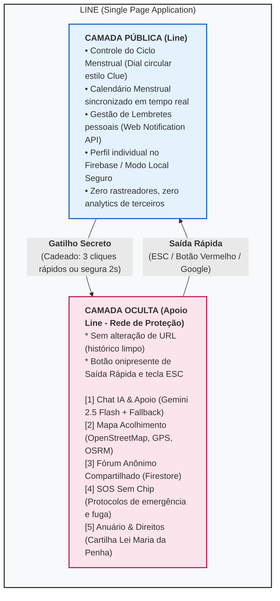
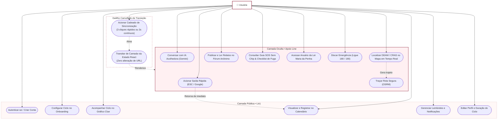
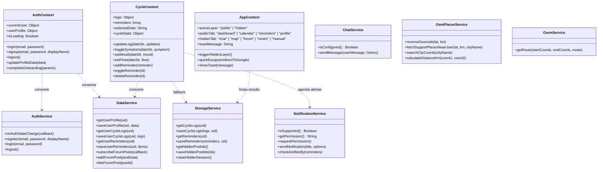
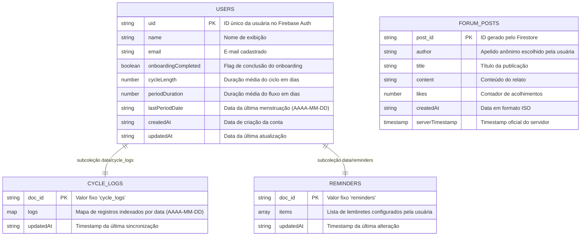

# Line • Plataforma Segura de Saúde Feminina & Apoio a Vítimas de Violência

> **Aplicação Web SPA Dual-Layer (Camada Dupla)** de alta privacidade, projetada com foco mobile-first para o acompanhamento do ciclo menstrual e suporte emergencial e sigiloso a mulheres em situação de vulnerabilidade doméstica.

---

## 1. Visão Geral, Problema e Solução

### 1.1. Definição do Problema
O projeto **Line** foi concebido para enfrentar duas problemáticas críticas e profundamente interligadas que afetam as mulheres:

1. **A Epidemia de Violência Doméstica e Subnotificação:**
   - **Estatísticas Alarmantes:** Segundo dados consolidados do Fórum Brasileiro de Segurança Pública e relatórios judiciais, o Brasil registrou mais de **945 mil casos de violência doméstica entre janeiro e setembro de 2026**, com mais de **29 milhões de mulheres** relatando ter sofrido algum tipo de agressão nos últimos 12 meses.
   - **Subnotificação Crítica (93%):** Estima-se que mais de 93% das vítimas não denunciam formalmente seus agressores de imediato por medo de retaliação, chantagem emocional, dependência econômica e receio de perder a guarda dos filhos.
   - **Barreiras Institucionais e Morosidade Judicial:** O machismo institucional ainda vitimiza a mulher em atendimentos despreparados, somando-se à morosidade do sistema penal, que demora em média **429 dias para o início de julgamento** de processos de violência doméstica.
   - **Vigilância Constante do Agressor:** Em relacionamentos abusivos, o parceiro frequentemente vigia o celular, histórico de chamadas, mensagens e aplicativos instalados da vítima.

2. **Violação Sistemática de Privacidade em Aplicativos de Saúde Feminina:**
   - Aplicativos populares de controle menstrual (como Flo, Maya e MIA) acumulam histórico comprovado de compartilhamento, venda e monetização de dados biométricos íntimos (frequência menstrual, sintomas, vida sexual, gravidez e localização) para redes de anúncios (Meta, Google) e corretores de dados.
   - Tal exposição vulnerabiliza a mulher em termos de planos de saúde, discriminação no ambiente de trabalho e quebra de sigilo de sua vida íntima.

### 1.2. Descrição da Solução: Arquitetura Dual-Layer
O **Line** é uma **Single Page Application (SPA)** responsiva (*mobile-first*), leve e otimizada para conexões móveis (3G/4G), estruturada em **duas camadas independentes**:




- **Camada Pública ("Line"):** Apresenta-se como um aplicativo moderno, elegante e completo para saúde feminina e registro do ciclo menstrual, sintomas, humor e lembretes diários.
- **Camada Oculta ("Apoio Line"):** Ativada exclusivamente através de um gatilho secreto camuflado na interface. Oferece assistência com Inteligência Artificial, mapeamento dinâmico de delegacias e centros de acolhimento em tempo real, fórum comunitário seguro e cartilhas de emergência.
- **Segurança de Navegação SPA:** A transição entre camadas ocorre **exclusivamente por estado React em memória (`useState`)**. A URL do navegador nunca é modificada, impossibilitando que inspeções posteriores no histórico revelem o acesso ao módulo de proteção.
- **Botão "Saída Rápida" (Quick Escape):** Presente de forma fixa em todas as telas ocultas. Com um toque ou ao pressionar a tecla `ESC`, fecha a sessão em memória e restaura imediatamente a tela do calendário menstrual ou redireciona a aba para a página inicial do Google.

---

## 2. Requisitos do Sistema

### 2.1. Requisitos Funcionais (RF)

| Identificador | Título | Descrição |
| :--- | :--- | :--- |
| **RF01** | **Autenticação Individual** | O sistema deve permitir login e cadastro individualizado com e-mail e senha via Firebase Auth (ou Modo Local Seguro em caso de ausência de rede/chaves), isolando os dados de cada usuária. |
| **RF02** | **Onboarding Menstrual** | No primeiro acesso pós-cadastro, o sistema deve apresentar uma etapa inicial para informar data da última menstruação, duração do ciclo (ex: 28 dias) e duração do fluxo (ex: 5 dias), calculando as previsões iniciais. |
| **RF03** | **Gráfico Interativo Clue-Style** | A tela inicial deve exibir um mostrador circular interativo indicando dia atual do ciclo, fase biológica (Menstruação, Folicular, Ovulação ou Lútea), chance de engravidar e atalhos rápidos para registro de humor e sintomas. |
| **RF04** | **Calendário Menstrual Integrado** | A aba Calendário deve navegar mês a mês e exibir em tempo real os dias de fluxo menstrual registrados, previsão do próximo ciclo, janela fértil e pico de ovulação, 100% sincronizada com o mostrador da tela inicial. |
| **RF05** | **Gestão de Lembretes & Alertas Reais** | O sistema deve permitir criar, ativar/desativar e excluir lembretes diários (água, anticoncepcional, exames), disparando alertas reais no sistema operacional via **Web Notification API**. |
| **RF06** | **Aba Perfil & Ajustes** | O sistema deve disponibilizar tela de perfil para alteração de nome, ajuste dos parâmetros de duração do ciclo/menstruação, reabertura do onboarding, teste de alertas e logout. |
| **RF07** | **Gatilho Secreto de Camuflagem** | O sistema deve disponibilizar um gatilho discreto na tela de Lembretes (ícone de cadeado de sincronização). Ao receber 3 cliques rápidos (<700ms) ou ser pressionado por 2 segundos, transita imediatamente para a Camada Oculta. |
| **RF08** | **Saída Rápida (Quick Escape)** | Todas as telas da Camada Oculta devem possuir botão de saída de emergência ("Voltar ao Calendário") e escuta global da tecla **ESC**, limpando a sessão oculta e restaurando o calendário público, além de atalho para redirecionamento imediato para `google.com`. |
| **RF09** | **Chat com IA Acolhedora (Gemini)** | O portal de apoio deve integrar o modelo **Gemini 2.5 Flash** configurado com system prompt focado em escuta empática, segurança da vítima e direitos da Lei Maria da Penha (com fallback inteligente caso a chave não esteja configurada ou o dispositivo esteja sem conexão). |
| **RF10** | **Mapa de Acolhimento em Tempo Real** | O sistema deve capturar a geolocalização do dispositivo via `watchPosition` (sem armazenar histórico em disco), buscar pontos de apoio reais (DEAM, CRAS, Delegacias) num raio de 15 km via Overpass API/Nominatim com trava de distância em 40 km, permitindo traçar rotas via OSRM. |
| **RF11** | **Fórum Comunitário Anônimo** | Espaço compartilhado no Firestore para publicação de relatos e apoio mútuo, permitindo que a usuária escolha seu próprio apelido anônimo, curta publicações e oculte posts localmente. |
| **RF12** | **Guia de SOS Sem Chip** | Seção contendo orientações táticas para acionamento de serviços de emergência (190, 180, 192, 193) em celulares sem chip ou sem saldo, além de checklist interativo para plano de fuga. |
| **RF13** | **Anuário & Direitos (Offline-First)** | Base de conhecimento estática e disponível offline contendo dados estatísticos sobre violência de gênero no Brasil, descrição dos 5 tipos de violência doméstica, medidas protetivas de urgência e passo a passo para denúncia. |

### 2.2. Requisitos Não Funcionais (RNF)

| Identificador | Categoria | Descrição |
| :--- | :--- | :--- |
| **RNF01** | **Privacidade e LGPD** | O aplicativo não deve incluir nenhum tipo de pixel de rastreamento (Meta Pixel, Google Analytics, trackers publicitários). Dados de saúde nunca são comercializados ou compartilhados. |
| **RNF02** | **Isolamento de Dados** | Cada conta de usuária possui seu próprio espaço isolado de armazenamento no Firestore e em `localStorage`, impedindo mistura de registros entre contas no mesmo dispositivo. |
| **RNF03** | **Navegação Segura (SPA)** | A alternância entre Camada Pública e Camada Oculta deve ocorrer sem manipulação de rotas ou histórico do navegador (`window.history`), garantindo que o histórico do browser aponte apenas para a URL inicial. |
| **RNF04** | **Privacidade de Geolocalização** | As coordenadas de latitude e longitude do dispositivo são mantidas exclusivamente em memória volátil (`useState`), sendo descartadas no desmonte do componente. Nenhuma coordenada de GPS é enviada ao Firebase ou salva no disco. |
| **RNF05** | **Desempenho e Leveza (3G/4G)** | A aplicação deve carregar com tempo de resposta inferior a 2 segundos em conexões 3G móveis, mantendo bundle enxuto com renderização puramente vetorial e SVGs embutidos. |
| **RNF06** | **Resiliência e Tolerância a Falhas** | Todo serviço externo (Firebase, Gemini API, Overpass API, Nominatim, OSRM) deve possuir um mecanismo de contingência funcional (fallback inteligente e modo local seguro) para que a usuária nunca fique desamparada. |

---

## 3. Documentação Técnica & Arquitetura

### 3.1. Stack Tecnológica Real

- **Core & Runtime:** [React 19](https://react.dev/) com JSX moderno e Hooks funcionais.
- **Ferramenta de Build & Bundler:** [Vite 6](https://vitejs.dev/) (ESM nativo com HMR instantâneo e compilação otimizada via Rollup).
- **Estilização & UI:** [Tailwind CSS 3.4](https://tailwindcss.com/) com utilitários customizados, fontes seguras (`Plus Jakarta Sans`) e [Lucide React](https://lucide.dev/) para iconografia vetorial.
- **Autenticação & Banco de Dados:** [Firebase 13.4](https://firebase.google.com/) (Firebase Authentication & Cloud Firestore) com fallback transparente para `localStorage`.
- **Inteligência Artificial:** SDK oficial [`@google/genai`](https://www.npmjs.com/package/@google/genai) consumindo o modelo `gemini-2.5-flash`.
- **Mapeamento & Geolocalização:** [Leaflet 1.9](https://leafletjs.com/) e [React-Leaflet 5.0](https://react-leaflet.js.org/) renderizando cartografia aberta do [OpenStreetMap](https://www.openstreetmap.org/).
- **Consultas Geoespaciais:** [Overpass API](https://overpass-api.de/) (com espelho em `overpass.kumi.systems`) + [Nominatim API](https://nominatim.openstreetmap.org/).
- **Roteamento Anônimo:** [OSRM (Open Source Routing Machine)](https://project-osrm.org/) para cálculo de trajetos a pé e de carro.
- **Notificações:** [Web Notifications API](https://developer.mozilla.org/pt-BR/docs/Web/API/Notifications_API) nativa do navegador.

### 3.2. Estrutura de Diretórios

```

Line/
├── index.html                      # Ponto de entrada HTML com viewport mobile-first
├── package.json                    # Dependências e scripts de execução/build
├── vite.config.js                  # Configuração do Vite e plugins
├── tailwind.config.js              # Configurações do Tailwind CSS
├── postcss.config.js               # Pipeline PostCSS
├── .env.example                    # Template de variáveis de ambiente
├── src/
│   ├── main.jsx                    # Inicialização e renderização do React DOM
│   ├── App.jsx                     # Shell principal com os provedores de contexto
│   ├── index.css                   # Folha de estilos globais e animações
│   │
│   ├── context/                    # Estado global da aplicação (React Context)
│   │   ├── AuthContext.jsx         # Gestão de sessão, login, cadastro e onboarding
│   │   ├── AppContext.jsx          # Estado da arquitetura Dual-Layer e Saída Rápida
│   │   └── CycleContext.jsx        # Estado sincronizado do ciclo, sintomas e lembretes
│   │
│   ├── services/                   # Camada de serviços e integrações externas
│   │   ├── firebase.js             # Inicialização do Firebase + Fallback Local Seguro
│   │   ├── gemini.js               # Conexão com Gemini API + Fallback empático
│   │   ├── notifications.js        # Gerenciamento da Web Notification API
│   │   ├── osmPlaces.js            # Busca real no OpenStreetMap (Overpass + Nominatim)
│   │   ├── osrm.js                 # Roteamento anônimo a pé/carro com OSRM
│   │   └── storage.js              # Utilitário de persistência limpa e isolada
│   │
│   ├── data/                       # Bases de dados e cartilhas offline-first
│   │   ├── safetyManual.js         # Dados da Lei Maria da Penha, estatísticas e direitos
│   │   └── offlineGuides.js        # Guias de SOS Sem Chip e checklist de fuga
│   │
│   └── components/
│       ├── auth/                   # Telas de login, cadastro e primeiro acesso
│       │   ├── AuthView.jsx        # Formulário acolhedor de autenticação
│       │   └── OnboardingModal.jsx # Configuração inicial do ciclo menstrual
│       │
│       ├── common/                 # Componentes compartilhados
│       │   ├── Header.jsx          # Cabeçalho adaptativo e limpo
│       │   └── QuickEscapeBar.jsx  # Botão fixo de Saída Rápida (ESC / Google)
│       │
│       ├── public/                 # Camada Pública (Saúde Feminina - Line)
│       │   ├── DashboardTab.jsx    # Gráfico circular Clue-style e resumo do dia
│       │   ├── CalendarTab.jsx     # Calendário mensal com fases e edição de logs
│       │   ├── RemindersTab.jsx    # Lista de lembretes + Gatilho secreto no cadeado
│       │   ├── ProfileTab.jsx      # Perfil da usuária, parâmetros do ciclo e logout
│       │   ├── LogModal.jsx        # Modal detalhado de sintomas, fluxo e humor
│       │   └── PublicBottomNav.jsx # Menu inferior da camada pública
│       │
│       └── hidden/                 # Camada Oculta (Portal de Apoio a Vítimas)
│           ├── HiddenNavigation.jsx # Menu superior com as 5 abas de apoio
│           ├── SafeChatTab.jsx     # Chat de acolhimento com IA (Gemini)
│           ├── SafeMapTab.jsx      # Mapa em tempo real com DEAMs, CRAS e rotas
│           ├── CommunityForumTab.jsx # Fórum anônimo compartilhado no Firestore
│           ├── NoSimEmergencyTab.jsx # Guia tático de emergência sem chip
│           └── SecurityYearbookTab.jsx # Cartilha da Lei Maria da Penha e MPU

```

### 3.3. Diagrama de Casos de Uso



### 3.4. Diagrama de Módulos e Componentes

O diagrama a seguir reflete as entidades, hooks, serviços e contextos reais do código React:



### 3.5. Modelagem do Banco de Dados (Firestore)

O armazenamento remoto utiliza o **Cloud Firestore** em estrutura NoSQL com coleções restritas e isoladas por usuário (`users`), além de uma coleção pública para a rede de apoio anônima (`forum_posts`):

#### Diagrama de Entidade-Relacionamento (MER NoSQL)



#### Detalhamento das Coleções e Documentos
1. **Coleção Privada `users/{uid}`:**
   - Armazena metadados da conta e parâmetros biológicos do ciclo menstrual da usuária.
   - **Subcoleção `users/{uid}/data/cycle_logs`:**
     - Contém o mapa `logs`, onde cada chave é uma data (`AAAA-MM-DD`) associada a `{ flow, mood, symptoms: [], notes }`.
   - **Subcoleção `users/{uid}/data/reminders`:**
     - Contém o array `items` com os objetos `{ id, title, time, frequency, enabled, createdAt }`.
2. **Coleção Pública `forum_posts/{postId}`:**
   - Publicações anônimas compartilhadas em tempo real entre todas as usuárias da plataforma.
   - Cada post possui `{ author, title, content, likes, createdAt, serverTimestamp }`.
   - Ações de ocultar post são salvas **apenas no cliente** (`line_hidden_post_ids`), respeitando a preferência individual de visualização.

---

### 3.6. APIs e Serviços Integrados

| Serviço / API | Propósito no Line | Endpoint / SDK Utilizado | Variáveis de Ambiente | Comportamento de Contingência / Fallback |
| :--- | :--- | :--- | :--- | :--- |
| **Firebase Auth & Firestore** | Autenticação individual e sincronização de dados de saúde e relatos | SDK Oficial `firebase/auth` e `firebase/firestore` | `VITE_FIREBASE_API_KEY`<br>`VITE_FIREBASE_PROJECT_ID`<br>`VITE_FIREBASE_AUTH_DOMAIN` | Ativa o **Modo Local Seguro** (persiste contas, ciclo e lembretes no `localStorage` isolado por ID). |
| **Google Gemini API** | Chat acolhedor especializado em direitos e Lei Maria da Penha | `@google/genai`<br>Modelo `gemini-2.5-flash` | `VITE_GEMINI_API_KEY` | Ativa o **Fallback Empático**, fornecendo orientações jurídicas, de abrigo e SOS pré-compiladas. |
| **OpenStreetMap (Tiles)** | Renderização de mapas vetoriais livres e sem rastreamento | `https://{s}.tile.openstreetmap.org/{z}/{x}/{y}.png` | Nenhuma (Gratuito / Open Source) | Mapa é renderizado diretamente pelo Leaflet em canvas leve. |
| **Overpass API** | Busca de DEAMs, CRAS e delegacias num raio de 15 km | `https://overpass-api.de/api/interpreter`<br>Espelho: `overpass.kumi.systems` | Nenhuma | Alterna automaticamente entre espelhos e complementa com Nominatim. |
| **Nominatim API** | Geocodificação reversa do município e busca de reforço por cidade | `https://nominatim.openstreetmap.org/reverse`<br>`/search` | Nenhuma (requer `User-Agent` customizado) | Extrai o município atual e faz buscas paralelas com `viewbox` delimitado. |
| **OSRM Routing** | Traçado de rotas seguras a pé e de carro | `https://router.project-osrm.org/route/v1/{mode}/` | Nenhuma | Calcula aproximação geodésica em curva e estima tempo de deslocamento. |
| **Web Notification API** | Disparo de alertas agendados de saúde e bem-estar no dispositivo | API nativa `window.Notification` | Nenhuma | Silencia alertas graciosamente caso a usuária não conceda permissão. |

---

## 4. Manual de Instalação e Execução

### 4.1. Pré-requisitos
- [Node.js](https://nodejs.org/) versão 18.x ou superior (recomendado Node 20+ LTS).
- Gerenciador de pacotes `npm` (versão 9+).
- Navegador web moderno (Chrome, Edge, Firefox, Safari ou navegadores móveis baseados em Chromium/WebKit).

### 4.2. Passo a Passo de Instalação

1. **Clonar ou abrir o repositório:**
   ```bash
   cd Line
   ```

2. **Instalar as dependências do projeto:**
   ```bash
   npm install
   ```

3. **Configurar as variáveis de ambiente:**
   Copie o arquivo de exemplo `.env.example` para `.env`:
   ```bash
   cp .env.example .env
   ```
   *(No Windows PowerShell: `Copy-Item .env.example .env`)*

4. **Executar em modo de desenvolvimento:**
   ```bash
   npm run dev
   ```
   O terminal exibirá o endereço local (geralmente `http://localhost:5173/`).

5. **Gerar compilação de produção (Build):**
   ```bash
   npm run build
   ```

---

### 4.3. Configuração de Variáveis de Ambiente

Abra o arquivo `.env` e insira suas credenciais:

```env
=============================================================================
# LINE - Variáveis de Ambiente (.env)
=============================================================================

# Chave de API do Google Gemini (necessária para o Chat de Apoio com IA)
# Obtenha gratuitamente em: https://aistudio.google.com/
VITE_GEMINI_API_KEY=sua_chave_gemini_aqui

# Configurações do Firebase (Opcional)
# Caso não configurado, o aplicativo roda automaticamente em Modo Local Seguro (Offline-First via LocalStorage)
VITE_FIREBASE_API_KEY=sua_firebase_api_key
VITE_FIREBASE_AUTH_DOMAIN=seu_projeto.firebaseapp.com
VITE_FIREBASE_PROJECT_ID=seu_projeto_id
VITE_FIREBASE_STORAGE_BUCKET=seu_projeto.appspot.com
VITE_FIREBASE_MESSAGING_SENDER_ID=seu_messaging_id
VITE_FIREBASE_APP_ID=seu_app_id
```

> [OBSERVAÇÃO]
> Se você optar por rodar sem configurar o Firebase, o **Line** operará perfeitamente no **Modo Local Seguro**, permitindo que você crie contas de teste e utilize todas as funcionalidades com isolamento em `localStorage`.

---

### 4.4. Execução em Rede Local & Requisitos de HTTPS (GPS e Notificações)

Para testar a experiência no celular (mobile real):
1. Inicie o servidor Vite expondo a rede local:
   ```bash
   npm run dev -- --host
   ```
2. Acesse pelo celular o endereço exibido no terminal (ex: `http://192.168.1.X:5173`).

> [!IMPORTANT]
> **Requisito de Segurança dos Navegadores:** As APIs de **Geolocalização precisa (GPS)** e **Notificações Web** exigem um contexto seguro (**HTTPS** ou `localhost`).
> - Ao testar em rede local no celular via `http://`, navegadores móveis podem restringir o GPS.
> - **Solução:** Utilize uma ferramenta de túnel seguro como [ngrok](https://ngrok.com/) (`ngrok http 5173`) ou [Cloudflare Tunnels](https://developers.cloudflare.com/cloudflare-one/connections/connect-networks/) para gerar uma URL `https://` válida para o celular, ou utilize a busca manual por cidade no mapa caso o GPS esteja bloqueado.

---

## 5. Manual da Usuária

### 5.1. Camada Pública: Lin)

1. **Cadastro e Onboarding Inicial:**
   - Na primeira tela, selecione **"Cadastre-se"**, informe seu nome, e-mail e crie uma senha.
   - Imediatamente após o cadastro, responda às 3 perguntas iniciais:
     - *Qual foi o primeiro dia da sua última menstruação?*
     - *Quantos dias costuma durar seu ciclo?* (padrão 28 dias).
     - *Quantos dias costuma durar sua menstruação?* (padrão 5 dias).
   - O aplicativo calcula automaticamente o dia atual do ciclo, fase biológica e estimativa do próximo período.

2. **Aba Início (Dashboard com Gráfico Clue-Style):**
   - Visualize o mostrador circular interativo que destaca o dia atual do ciclo e a fase biológica em que você se encontra.
   - Toque nos botões rápidos de **Humor** (🌸 Calma, ✨ Animada, 🥺 Sensível, 💭 Ansiosa) ou selecione seu **Fluxo Menstrual** (Nenhum, Leve, Médio, Intenso) para registrar dados do dia.
   - Toque no botão **"+ Registro Diário"** para abrir o modal completo e anotar cólicas, inchaço, disposição e observações pessoais.

3. **Aba Calendário (Sincronização em Tempo Real):**
   - Navegue pelos meses através das setas laterais.
   - **Legenda Visual Intuitiva:**
     - 🔴 **Vermelho contínuo:** Dias com fluxo menstrual registrado pela usuária.
     - ⚪ **Tracejado rosa:** Previsão dos próximos dias de menstruação com base na duração configurada.
     - 🌸 **Rosa suave:** Janela fértil prevista.
     - 🟣 **Borda destacada:** Pico estimado da ovulação.
   - Toque em qualquer dia passado ou futuro para consultar ou editar registros.

4. **Aba Lembretes (Notificações Reais):**
   - Caso ainda não tenha concedido permissão, toque em **"Permitir"** no card de notificações.
   - Toque em **"+ Novo Lembrete"**, digite o título (ex: *Tomar anticoncepcional* ou *Beber água*), selecione o horário e a frequência.
   - O navegador disparará notificações no horário programado. Você pode ativar/desativar lembretes pelo interruptor ou excluí-los a qualquer momento.

5. **Aba Perfil:**
   - Visualize os dados da conta ativa.
   - Altere seu nome de exibição, a duração média do ciclo (20 a 45 dias) e a duração do fluxo.
   - Faça o teste da notificação ou refaça o onboarding inicial caso tenha tido alterações hormonais.

---

### 5.2. Como Ativar o Modo Oculto: Apoio Line

O acesso à rede de apoio é protegido por camuflagem discreta para que a vítima possa acioná-lo com segurança mesmo na presença de outras pessoas:

1. Acesse a aba **Lembretes** no menu inferior.
2. Na parte inferior da tela, localize o card discreto intitulado **"Privacidade & Sincronização em Nuvem"**.
3. **Acione o Gatilho Secreto:**
   - **Método 1 (Toque Rápido):** Toque **3 vezes seguidas** no ícone de **Cadeado** em menos de 1 segundo; OU
   - **Método 2 (Pressionar Contínuo):** Mantenha o dedo pressionado sobre o **Cadeado** por **2 segundos** (um anel de carregamento ao redor do ícone indicará o progresso).
4. O aplicativo transita instantaneamente para a Camada Oculta **"Apoio Line"**, sem alterar a URL do navegador.

---

### 5.3. Navegação nas 5 Ferramentas de Apoio

Na camada oculta, você dispõe de 5 abas principais acessíveis no menu superior:

1. **💬 Chat IA & Apoio:**
   - Converse anonimamente com a assistente virtual treinada na Lei Maria da Penha.
   - Esclareça dúvidas sobre medidas protetivas, acolhimento com filhos e tipos de violência.
   - Utilize as **Respostas Rápidas** sugeridas na parte inferior do chat para agilizar mensagens em momentos de tensão.

2. **🗺️ Mapa Acolhimento:**
   - O aplicativo solicita permissão de GPS e rastreia sua posição em tempo real (`watchPosition`).
   - Busca pontos reais num raio de 15 km: **Delegacias Especializadas da Mulher (DEAM)**, **CRAS/CREAS** e **Delegacias de Polícia**.
   - Toque no ponto desejado para ver o endereço, distância exata e traçar rotas seguras a pé ou de carro (via OSRM ou Google Maps externo).
   - Toque em **"Centralizar em mim"** sempre que precisar recentralizar o mapa.
   - *Caso não haja pontos em 15 km:* O mapa alerta com clareza e destaca botões diretos para discagem do **Ligue 180** e **190**.

3. **👥 Fórum Anônimo:**
   - Veja desabafos e mensagens de apoio de outras mulheres em tempo real.
   - Altere seu **Apelido Anônimo** no topo da tela quando desejar.
   - Toque em **"Novo Relato"** para compartilhar sua história com total sigilo.
   - Use o ícone de olho riscado caso deseje ocultar postagens específicas no seu aparelho.

4. **📶 SOS Sem Chip:**
   - Consulte o guia prático explicando como funciona a tecnologia de chamadas de emergência pela rede de qualquer operadora móvel mesmo sem chip (SIM) ou sem créditos.
   - Utilize o **Checklist Interativo de Fuga** para conferir itens vitais (documentos, chaves, remédios, dinheiro guardado) antes de sair de um ambiente hostil.

5. **📖 Anuário & Direitos:**
   - Cartilha jurídica disponível offline detalhando os 5 tipos de violência doméstica (física, psicológica, sexual, patrimonial e moral).
   - Passo a passo completo de como solicitar Medidas Protetivas de Urgência (MPU) na delegacia sem custos e sem advogado.

---

### 5.4. Acionamento da Saída Rápida (Quick Escape)

Caso alguém se aproxime ou você precise disfarçar o uso imediatamente:

- **No Computador:** Pressione a tecla **ESC** em qualquer momento; OU
- **No Celular:** Toque no botão vermelho **"Saída Rápida (ESC) / Voltar ao Calendário"** fixo no topo da tela.
- **Redirecionamento para o Google:** Toque no botão preto **"Google"** para limpar o DOM da página e redirecionar imediatamente a aba para o site do Google.

Em milissegundos, a sessão em memória é purgada e a tela inicial do calendário menstrual é reexibida.

---

## 6. Testes de Funcionalidade e Changelog de Estabilização

### 6.1. Matriz de Testes de Funcionalidade

| Cenário de Teste | Comportamento Esperado | Status |
| :--- | :--- | :---: |
| **Autenticação Individual** | Cadastro com e-mail/senha cria conta individual com isolamento de registros. | **Aprovado** |
| **Onboarding Pós-Cadastro** | Exibe modal solicitando ciclo, fluxo e última menstruação; calcula parâmetros corretamente. | **Aprovado** |
| **Sincronização Clue ↔ Calendário** | Gráfico circular e calendário mensal refletem rigorosamente o mesmo dia do ciclo e previsões. | **Aprovado** |
| **Registro Diário de Sintomas** | Adicionar fluxo/humor atualiza simultaneamente o calendário e o gráfico em tempo real. | **Aprovado** |
| **Notificações Reais do Navegador** | Solicita permissão da usuária e dispara notificações sonoras/visuais no horário programado. | **Aprovado** |
| **Transição Camuflada para Modo Oculto** | 3 cliques rápidos ou segurar 2s no cadeado abre o Apoio Line **sem alterar a URL**. | **Aprovado** |
| **Saída Rápida (Quick Escape / ESC)** | Pressionar ESC ou tocar no botão vermelho fecha o modo oculto e restaura o calendário. | **Aprovado** |
| **Chat de Acolhimento com IA** | Gemini 2.5 Flash responde com linguagem humanizada e orientações jurídicas precisas. | **Aprovado** |
| **Fallback Inteligente do Chat** | Ausência de chave ou de internet aciona respostas de contingência completas. | **Aprovado** |
| **Geolocalização em Tempo Real** | Captura `watchPosition`, exibe marcador pulsante "Você está aqui" e centraliza via `flyTo`. | **Aprovado** |
| **Busca Dinâmica de Pontos de Apoio** | Overpass API + Nominatim buscam DEAMs e CRAS em 15 km com trava estrita de 40 km. | **Aprovado** |
| **Tratamento de 0 Locais no Raio** | Regiões sem pontos cadastrados no OSM exibem alerta claro e atalhos Ligue 180 e 190. | **Aprovado** |
| **Fórum Anônimo Compartilhado** | Publicações com apelido personalizável sincronizam no Firestore e iniciam sem mocks falsos. | **Aprovado** |
| **Anuário e Guias Offline** | Toda a base legal e guia de emergência sem chip são renderizados sem dependência de rede. | **Aprovado** |

---

### 6.2. Changelog de Estabilização & Correções

1. **Reengenharia Completa do Mapa de Acolhimento:**
   - Implementação de rastreamento contínuo com `navigator.geolocation.watchPosition` e desalocação de memória no unmount via `clearWatch`.
   - Busca geoespacial dinâmica: geocodificação reversa no Nominatim, consulta ao Overpass API (com espelho de contingência) e busca com bounding box no Nominatim.
   - Aplicação de **trava de distância estrita de 40 km** via fórmula de Haversine e ordenação de proximidade (do mais próximo ao mais distante).
   - Inclusão de estado dedicado para 0 locais no raio de 15 km com atalhos de emergência e aviso de segurança sobre casas-abrigo sigilosas.
3. **Sincronização em Tempo Real Clue ↔ Calendário:**
   - Eliminação de divergências entre o mostrador circular da Home e a aba Calendário. O estado é centralizado no `CycleContext`, garantindo visualização idêntica de fases, dias férteis e previsões.
4. **Limpeza e Otimização da Interface:**
   - Remoção do card de backup na página inicial para evitar suspeitas de terceiros.
   - Eliminação de seções desnecessárias na aba Lembretes (como guias externos e filtros) para manter foco exclusivo na agenda pessoal da usuária.
5. **Autenticação, Perfil e Fórum Real no Firebase:**
   - Integração completa com Firebase Authentication e Cloud Firestore para sincronização em nuvem e persistência isolada por conta.
   - Ativação funcional da aba Perfil no menu inferior com suporte a atualização de duração de ciclo, fluxo e logout.
   - Fórum anônimo compartilhado com personalização livre de apelidos e escuta em tempo real (`onSnapshot`).

---

## 7. Matriz de Análise de Riscos

| ID | Categoria | Descrição do Risco | Prob. | Impacto | Estratégia de Mitigação Implementada no Line |
| :---: | :---: | :--- | :---: | :---: | :--- |
| **R01** | **Segurança da Vítima** | Agressor assume o controle do aparelho enquanto o modo de apoio está visível. | Média | **Crítico** | Botão **Saída Rápida** fixo no topo de todas as telas ocultas + escuta global da tecla **ESC**. Limpeza imediata de cache/sessão e retorno instantâneo para o calendário menstrual. |
| **R02** | **Privacidade** | Agressor inspeciona o histórico de URLs do navegador. | Alta | **Crítico** | Arquitetura **Single Page Application (SPA)** com troca de camadas exclusivamente via `useState`. A URL da barra de endereços nunca muda. |
| **R03** | **Vazamento de Dados** | Monitoramento de tráfego por corretores de dados ou anúncios de terceiros. | Alta | **Crítico** | **Zero rastreadores/analytics de terceiros**. Os dados são mantidos em banco privado da usuária ou exclusivamente em `localStorage` local. |
| **R04** | **Geolocalização** | Coordenadas de GPS gravadas em disco ou histórico de navegação. | Média | Alto | As coordenadas de GPS são mantidas **estritamente em memória volátil** (`useState`), nunca sendo salvas em `localStorage`, cookies ou Firebase. |
| **R05** | **Conectividade** | Falta de internet ou aparelho sem chip no momento de perigo. | Alta | Alto | Arquitetura **Offline-First**: cartilha jurídica, dicas de emergência sem chip e checklist de fuga funcionam sem conexão. O discador aciona 190/180 nativamente pelo sistema telefônico. |
| **R06** | **Restrições de HTTPS** | Navegador bloqueia GPS ou notificações em redes locais não seguras (`http://`). | Média | Médio | Sistema detecta bloqueio de GPS e oferece campo para **busca manual de cidade/bairro**, além de orientações para uso de túnel HTTPS em celulares. |
| **R07** | **Sobrecarga de APIs** | Lentidão ou bloqueio da Overpass API ou Gemini API. | Média | Médio | Implementação de **espelhos de contingência** no Overpass, busca paralela no Nominatim e **respostas empáticas de fallback** no chat com IA. |

---

## 8. Licença e Considerações Éticas

Este projeto é desenvolvido para fins de impacto social, pesquisa e proteção aos direitos fundamentais das mulheres.

- **Uso Responsável:** É proibida a utilização deste código para desenvolvimento de ferramentas de espionagem, comercialização de dados de saúde ou qualquer finalidade que comprometa a integridade física e psicológica de mulheres.
- **Atendimento de Urgência:** O aplicativo **Line** é uma ferramenta de apoio e não substitui a atuação imediata das autoridades policiais e do Poder Judiciário. Em situações de perigo iminente, ligue imediatamente para o **190 (Polícia Militar)** ou **180 (Central de Atendimento à Mulher)**.

---

*Line • Protegendo a privacidade de quem cuida de si, apoiando a coragem de quem precisa de ajuda.* 🌸🛡️