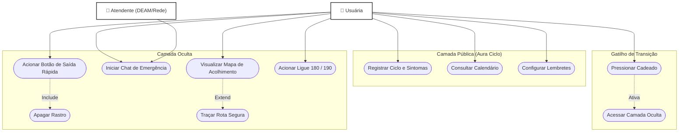
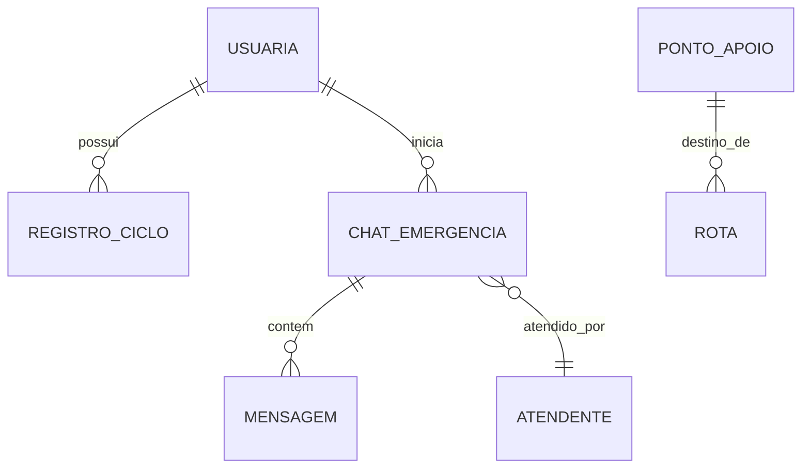
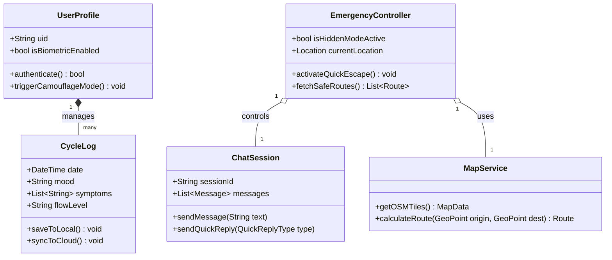

# Documentação Inicial de Projeto: Plataforma Segura de Saúde Feminina e Apoio a Vítimas de Violência

## 1. Definição do Problema
O projeto visa resolver duas problemáticas graves e interligadas que afetam as mulheres no Brasil: a epidemia de violência doméstica estrutural e a violação de privacidade em aplicativos de saúde feminina.

- **Contexto Social e Violência:** A violência doméstica atinge números alarmantes, com o Brasil registrando mais de 945 mil casos apenas entre janeiro e setembro de 2026, além de 29 milhões de mulheres relatando situações de violência nos últimos 12 meses. Contudo, há uma subnotificação crítica (93% das vítimas fora dos registros oficiais). As barreiras para a denúncia incluem o machismo institucional (que vitimiza a mulher em delegacias e hospitais), a dependência financeira, o medo de retaliação e a descrença na justiça, que demora em média 429 dias para iniciar o julgamento de processos de violência doméstica.

- **Contexto Tecnológico e Privacidade:** Aplicativos de controle menstrual populares (como Flo, Maya e MIA) apresentam um histórico de vazamento e venda de dados sensíveis (ciclo menstrual, atividade sexual, uso de anticoncepcionais, localização) para fins publicitários. Isso expõe as mulheres a riscos de discriminação empregatícia, encarecimento de planos de saúde e quebra de sigilo, evidenciando a necessidade de uma plataforma onde dados de saúde tenham segurança absoluta e não sejam monetizados.

---

## 2. Descrição da Solução
A solução é uma aplicação web de dupla camada (Dual-Layer Application). A superfície pública e visível da plataforma funciona como um site seguro, livre de rastreadores e focado no controle do ciclo menstrual e saúde feminina. De forma oculta, através de gatilhos de interface camuflados (UI Masking), a plataforma revela sua segunda camada: um portal de emergência para vítimas de risco. Este ambiente seguro fornece acesso a suporte via chat, contato direto com a Delegacia Especializada de Atendimento à Mulher (DEAM), localização de abrigos temporários e orientações sobre a Lei Maria da Penha.
A camuflagem resolve o problema do isolamento e do controle do agressor, permitindo que a vítima busque ajuda sem levantar suspeitas ao utilizar o celular ou computador.

---

## 3. Requisitos Funcionais (RF)
- **RF01 - Módulo Público (Saúde):** O sistema deve permitir o registro do ciclo menstrual, sintomas, humor e fluxo, funcionando como um calendário de saúde completo.
- **RF02 - Gatilho de Camuflagem:** O sistema deve possuir um mecanismo de ativação secreto (ex: entrar nas configurações e apertar um botão) para transitar da interface de saúde para o portal de apoio.
RF03 - Botão de Pânico (Quick Escape): O sistema deve conter um botão onipresente na área oculta que, ao ser clicado, volte imediatamente para a tela inicial do controle menstrual.
- **RF04 - Comunicação de Emergência:** O sistema deve oferecer um chat integrado e encriptado para contato com redes de apoio (psicológico ou jurídico) e atalhos de discagem rápida/acionamento da DEAM e Ligue 180.
- **RF05 - Mapa de Acolhimento:** O sistema deve mapear e exibir rotas seguras para abrigos temporários, CRAS e delegacias, baseando-se na geolocalização (solicitada apenas no modo de emergência e sem armazenamento de histórico).
RF06 - Conteúdo Educativo Offline-First: O sistema deve disponibilizar informações sobre direitos legais e fluxos de denúncia que possam ser acessadas mesmo em conexões instáveis.

---

## 4. Requisitos Não Funcionais (RNF) e Diretrizes Técnicas
- **RNF01 - Privacidade e LGPD:** É terminantemente proibida a integração de SDKs de publicidade ou rastreamento de terceiros (como Meta Pixel ou Google Analytics). Dados de saúde não poderão, sob nenhuma hipótese, ser utilizados para direcionamento de anúncios.
- **RNF02 - Arquitetura de Armazenamento Local:** Para garantir que os dados não sejam vazados no servidor (mitigando problemas vistos em concorrentes), os registros do ciclo menstrual devem ser preferencialmente armazenados localmente no dispositivo da usuária (usando IndexedDB ou Local Storage). Sincronização em nuvem, se existirem, devem usar criptografia ponta a ponta.
- **RNF03 - Segurança do Estado da Navegação (Single Page Application):** A aplicação deve ser construída como uma SPA (ex: React, Vue). Isso permite que a mudança do modo "calendário" para o modo "emergência" ocorra via alteração de estado dos componentes virtuais, sem alterar a URL no navegador. Se o agressor verificar o histórico do browser, constará apenas o acesso à página principal da ferramenta de saúde.
- **RNF04 - Desempenho e Acessibilidade:** A interface deve ser leve para garantir carregamento instantâneo em redes 3G/4G precárias, considerando que 56% das vítimas vivem em famílias com renda de até dois salários mínimos e podem ter acesso limitado a dados móveis.

---

## 5. Arquitetura de Software e Stack Tecnológica
O sistema operará sob uma arquitetura **Dual-Layer** (Camada Dupla), utilizando tecnologias modernas para garantir performance e segurança:

* **Frontend (Mobile & Web):** Flutter e Dart. Permite compilar tanto para aplicativos nativos (iOS/Android) quanto para Web.
* **Backend & Serviços Cloud:** Firebase.
    * *Authentication:* Autenticação anônima por padrão; login biométrico opcional.
    * *Firestore:* Banco de dados NoSQL para sincronização em nuvem (quando autorizada).
    * *Cloud Functions:* Para intermediar o chat com a DEAM/Atendentes sem expor o banco de dados diretamente.

* **Geolocalização e Rotas:**
    * *Mapas:* Biblioteca `flutter_map` com tiles do **OpenStreetMap** (gratuito e sem rastreamento de Big Techs).
    * *Rotas:* API do **OpenRouteService** ou **OpenStreetMap** para traçar rotas a pé ou de carro até abrigos/DEAMs de forma anônima.

---

## 6. Diagrama de Casos de Uso
O fluxo reflete a divisão entre a interface de saúde e a interface de apoio.

---

## 7. Modelagem de Banco de Dados

Como o Firebase Firestore é um banco **NoSQL orientando a documentos**, a modelagem relacional (MER/DER estrito) é adaptada para o conceito de **Coleções e Documentos**, otimizando leituras e garantindo a segregação de dados sensíveis.

### 7.1. Modelo Conceitual de Entidades (MER)

### 7.2. Modelo Lógico/Físico (DER em Estrutura NoSQL - Firestore)
Para garantir segurança, os dados da camada pública e da camada oculta **não devem coexistir no mesmo documento**.

* **Coleção `users`** (Acesso restrito à própria usuária via regras do Firestore):
* `uid` (String, Auth ID)
* `device_token` (String, para notificações)
* `biometric_enabled` (Boolean)
    * *Subcoleção:* `cycle_logs` (Dados criptografados ponta a ponta)
    * `date` (Timestamp)
    * `mood` (String)
    * `symptoms` (Array of Strings)

* **Coleção `emergency_sessions`** (Criada apenas quando o modo oculto é ativado; possui TTL para autoexclusão):
* `session_id` (String)
* `user_uid` (String)
* `status` (String: "active", "closed")
* `started_at` (Timestamp)
    * *Subcoleção:* `messages`
    * `sender` (String: "user" | "agent")
    * `text` (String)
    * `timestamp` (Timestamp)
    * `quick_reply_used` (Boolean)

* **Coleção `safe_locations`** (Pública para leitura, estática):
* `type` (String: "DEAM", "Abrigo", "Hospital")
* `name` (String)
* `coordinates` (GeoPoint)
* `24h` (Boolean)

---

## 4. Diagrama de Classes (Flutter/Dart Core)
Este diagrama representa a estrutura central dos modelos no aplicativo utilizando Dart, refletindo o isolamento da lógica de estado (State Management, ex: usando Provider, Riverpod ou BLoC).

---

## 5. Análise de Riscos Completa

A matriz de riscos abaixo avalia as vulnerabilidades do projeto em três frentes: **Segurança da Usuária (U), Tecnologia (T) e Negócio/Compliance (C)**.

| ID | Categoria | Risco | Prob. | Impacto | Estratégia de Mitigação (Contramedida) |
| --- | --- | --- | --- | --- | --- |
| **R01** | **U** | Agressor descobre o modo de emergência no celular da vítima. | Média | **Crítico** | Gatilho complexo e não intuitivo (ex: pressionar o ícone de cadeado na aba de lembretes). Ausência de menções a segurança na App Store (marketing focado apenas em saúde).|
| **R02** | **U** | Agressor confisca o celular durante a navegação no modo de apoio. | Alta | **Crítico** | Botão "Saída Rápida" fixo no topo. Ao acionar, fecha a sessão do Firebase, limpa cache e redireciona para o Google.|
| **R03** | **T** | Falta de conexão com internet no momento da emergência. | Alta | Alto | Arquitetura *Offline-First*. O app mantém os dados de cartilhas, leis e mapa básico em cache local (Local Storage/Hive no Flutter). Apenas chat em tempo real e rotas precisas dependem de rede. |
| **R04** | **T** | Vazamento de dados em nuvem (ataque ao Firebase). | Baixa | Alto | Dados de saúde sensíveis armazenados preferencialmente no dispositivo (`sqflite` ou `Hive`). Sincronização em nuvem opcional via encriptação de ponta-a-ponta (chave derivada da biometria/senha da usuária). |
| **R05** | **C** | Rastreamento de localização vazado para terceiros. | Média | Alto | Uso estrito do OpenStreetMap e OpenRouteService. A localização (GPS) só é ativada dentro do modo de emergência e **não** é salva em nenhum banco de dados após o fim do uso da rota. |
| **R06** | **U/T** | Demora no carregamento do app em aparelhos antigos/redes 3G. | Alta | Média | Limitar o uso de animações pesadas no Flutter. Otimizar assets visuais. Manter o tamanho do pacote do app (APK/AAB) inferior a 25MB. |